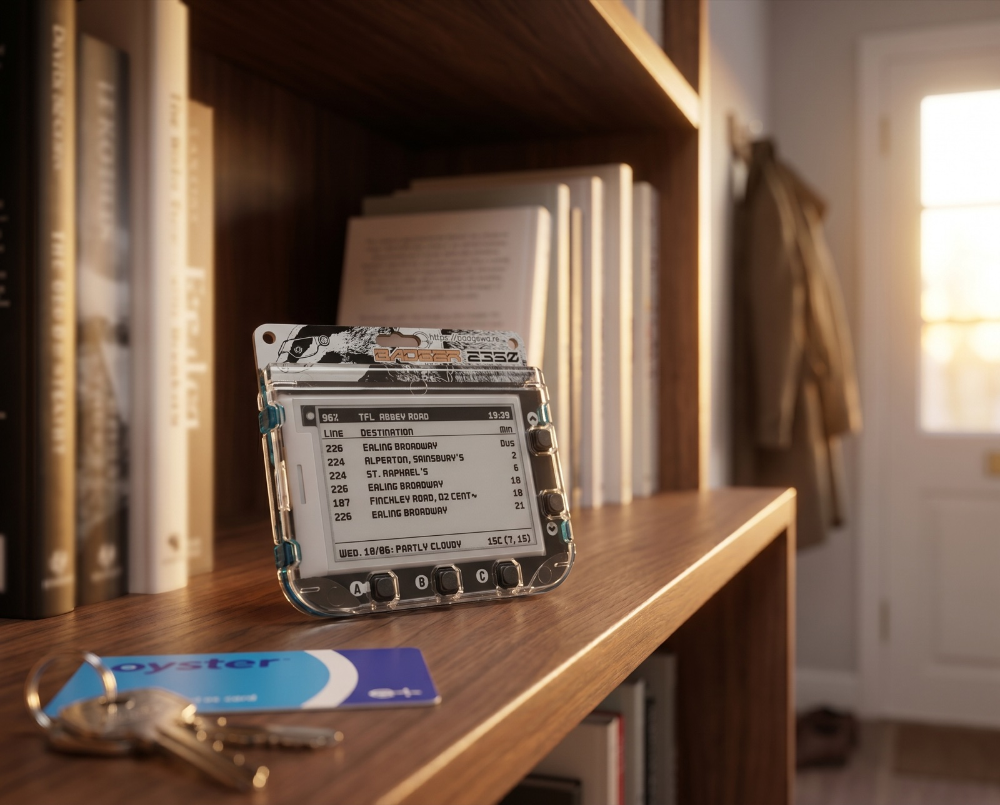

#  Badger 2350 — TfL Bus Arrivals Display

A MicroPython app for the [Pimoroni Badger 2350](https://shop.pimoroni.com/products/badger-2350) e-ink badge that turns it into a tiny live departures board for a London bus stop, with a one-line weather summary underneath.

```
+------------------------------------------------------------+
| 84%   TFL  Abbey Road                         08:47        |
|------------------------------------------------------------|
| Line   Destination                               Min       |
| ---------------------------------------------------------- |
| 18     Euston                                      2       |
| 27     Camden Town                                 5       |
| ...                                                        |
| ---------------------------------------------------------- |
| Sat. 30/05: Partly cloudy             12C (9, 18)          |
+------------------------------------------------------------+
```



## Features

- Live arrival predictions for any TfL bus stop, refreshed every 2 minutes (configurable)
- Current conditions + today's high/low for any location, via wttr.in, refreshed hourly
- Battery-aware: deep-sleeps between refreshes, shows a voltage-derived charge percentage, and latches into a static low-battery "death screen" instead of dying on stale data which might be missed on a quick glance
- Quiet hours: parks overnight (default 22:30–05:30) behind a friendly notice, waking only hourly for a clock/battery/weather heartbeat — press A any time to resume live updates during quiet hours
- Resilient weather: a failed hourly fetch is retried 3 more times over the next few minutes before the footer is dropped
- Closure-aware: detects a TfL stop closure (a separate endpoint from arrivals), transparently fails over to a configured neighbour stop, and shows a `{stop} Closed` banner — so you never get live times for a stop no bus will pull into
- Self-heals its clock after a full battery death (NTP re-sync, gated so it never runs on normal wakes), and keeps the right UK time all year: it stores UTC and applies British Summer Time automatically, so the spring/autumn clock change needs no intervention
- **Button A** forces an immediate refresh of both buses and weather

## Hardware & firmware requirements

| Item | Requirement |
|------|-------------|
| Device | Pimoroni Badger 2350 |
| Firmware | **Badgeware v2.0.2** (the v2.x API — older "v4" BadgerOS examples are incompatible) |
| Network | 2.4 GHz WiFi |

No TfL API key is required at the default refresh rate (the unauthenticated limit is 50 req/min; this app makes ~30 req/hour).

## Installation

1. **Enter disk mode:** with the badge powered, double-tap **RESET**. A disk named `BADGER` appears — its root *is* the device's `/system` folder.
2. **Copy the app:** create `apps/tfl/` on the disk and copy `__init__.py` and `icon.png` into it. Both filenames are mandatory — the launcher only lists folders containing a file literally named `icon.png`, and the entry point must be `__init__.py`.
3. **WiFi credentials:** copy `secrets.py.example` to the disk root as `secrets.py` (i.e. `/system/secrets.py` on the device) and fill in your SSID and password.
4. **Set your stop:** edit `STOP_ID` and `STOP_NAME` at the top of `__init__.py` (see [Finding your stop ID](#finding-your-stop-id)), and `WEATHER_LOCATION` if you want weather for somewhere other than Westminster.
5. Safely eject the disk, press **RESET**, and launch *tfl* from the menu.

### Finding your stop ID

The `STOP_ID` is TfL's Naptan ID (e.g. `490003028E`). The easiest way to find yours: search your stop on [tfl.gov.uk](https://tfl.gov.uk) bus arrivals and look at the URL, or query
`https://api.tfl.gov.uk/StopPoint/Search/{your stop name}` in a browser and pick the `id` of the right stop (the trailing letter distinguishes direction/side of road).

## Configuration

The main knobs, all at the top of `__init__.py`:

| Variable | Default | What it does |
|----------|---------|--------------|
| `STOP_ID` / `STOP_NAME` | — | TfL Naptan ID to monitor, and the header label |
| `MAX_BUSES` | `6` | Rows shown (6 fits the layout) |
| `REFRESH_MINS` | `2` | Wake/fetch interval — the main battery lever |
| `WEATHER_LOCATION` | `Westminster` | wttr.in place name |
| `WEATHER_MAX_STALE_MINS` | `60` | Weather retry interval *and* the age past which the footer is hidden |
| `QUIET_START` / `QUIET_END` | `"22:30"` / `"05:30"` | Overnight pause window — no bus fetching, hourly heartbeat only. Set either to `None` to disable |
| `ALT_STOP_ID` / `ALT_STOP_NAME` | `490004555P` / `Buckingham Palace Rd` | Neighbour stop to fail over to while `STOP_ID` is closed, and its (short) header label. Set `ALT_STOP_ID = None` for a closure notice with no failover |
| `LOW_BATT_VOLTS` | `3.45` | Voltage at which the low-battery screen latches |

The full list — including timeouts, the low-battery hysteresis pair, the LiPo calibration curve, and which layout values are safely tweakable — is in [docs/CONFIGURATION.md](docs/CONFIGURATION.md).

## How it works (short version)

On battery the app lives in a *wake → fetch → draw → arm alarm → deep sleep* cycle. Deep sleep is a full reset on this firmware, so cached arrivals, weather, and timestamps are persisted to flash via the `State` API and rehydrated on every wake. The RTC alarm that drives the periodic wake is armed with a verified retry — the device only sleeps once an alarm is confirmed set, because sleeping without one means it never wakes again (I learned this the hard way). On USB power the badge never deep-sleeps, so the same loop runs continuously with time-based gating to avoid hammering the e-ink.

The longer version — architecture, resilience behaviour, and every firmware quirk encountered — lives in the docs:

- **[docs/CONFIGURATION.md](docs/CONFIGURATION.md)** — every setting, with guidance
- **[docs/FIRMWARE-NOTES.md](docs/FIRMWARE-NOTES.md)** — Badgeware v2.x field notes (injected globals, RTC behaviour, battery readings, e-ink greys)
- **[docs/TROUBLESHOOTING.md](docs/TROUBLESHOOTING.md)** — symptom → cause → fix
- **[HANDOFF.md](HANDOFF.md)** — the complete development log and source-of-truth design document. Code comments cross-reference it by `§` section

## Screens you may see

- **Normal:** the table above.
- **Stale:** the column headers are replaced by `Stale - N min ago - press A` when a refresh fails but cached data exists. Clears on the next successful fetch.
- **Error:** `WiFi failed / Could not fetch - press A to retry` — only when there is *no* cached data (e.g. first launch while offline).
- **Quiet hours:** overnight (default 22:30–05:30) the table is replaced by a notice that buses are still running but the badge is asleep to conserve battery. The header clock/battery and the weather footer refresh hourly; **press A** for 30 minutes of live updates, after which it parks again.
- **Closure:** when TfL reports `STOP_ID` closed, an inverted `{stop} Closed` banner appears above the weather line, the header retitles to `ALT_STOP_ID`, and the arrivals below are the neighbour stop's — so the times are ones you can actually act on. Clears automatically when the closure ends.
- **Low battery:** a full-screen battery glyph with the voltage reading. The app pauses all activity, holds this image (e-ink needs no power to do so), and polls every 15 minutes for a charger. Plug in USB-C to resume.

## Dependencies

Everything ships with Badgeware v2.0.2 — there is nothing to `pip install`. The app uses the firmware's injected globals (`screen`, `badge`, `rtc`, `State`, …), MicroPython stdlib (`time`, `socket`, `json`, `network`, `requests`), the [TfL Unified API](https://api.tfl.gov.uk) (no key) and [wttr.in](https://wttr.in) (plain HTTP — HTTPS to wttr.in fails on this board; the TfL call is HTTPS and fine).

## License

MIT — see [LICENSE](LICENSE).

## Acknowledgements

Pimoroni for the Badger 2350 and Badgeware; TfL for the open arrivals API; [wttr.in](https://github.com/chubin/wttr.in) for keyless weather.
